# AlertaUNI — Muro de Anuncios (Proyecto Integrador, Parte 2)

Implementación en **Jetpack Compose** del rediseño del Muro de Anuncios que propusimos en el examen práctico, sobre la aplicación base del curso. Se respetó la arquitectura **MVVM** (Compose → ViewModel con `StateFlow` → repositorios → Supabase / Room) y se conservaron las funciones existentes (comentarios, contactos, cursos, inicio de sesión con Google).

## Integrantes

- Chilo Huillca, Oscar Raul
- Garcia Valdivia, Ronald Pablo
- Huamani Condori, Jeanpiero Sixto
- Payehuanca Riquelme, Jhastyn Jefferson
- Turpo Huanca, Wilson Josue

## Qué se implementó

| Tarea | Implementación |
|---|---|
| **1. Interfaz** | Muro rediseñado: buscador siempre visible, filtros por curso y privados, tarjetas compactas con curso, destinatario, fecha relativa y prioridad. La publicación pasa de un diálogo a una hoja inferior con la pregunta «¿Para quién es?». También hay una bandeja de archivados y se actualiza jalando la lista hacia abajo. |
| **2A. Anuncios privados** | En «Un estudiante» se busca al alumno entre los inscritos en los cursos del docente, se redacta el anuncio y se envía al backend (`add-post-private`) asociado a ese alumno. En el muro, el anuncio muestra el candado y el **nombre del destinatario**. |
| **2B. Búsqueda** | Busca en el título, el contenido o el nombre del alumno, y los resultados cambian mientras se escribe. Si no hay coincidencias muestra *«Sin resultados para …»*, y la ✕ vuelve al muro completo. Se puede combinar con los filtros. |
| **3. Borradores (Room)** | La tabla `borradores` (`DraftEntity`, `DraftDao`, `DraftRepository`) se puede guardar, continuar editando y publicar. Los datos sobreviven al cierre de la app. Cada borrador lleva el `ownerId` del usuario de Supabase, así que **otra cuenta no ve los borradores ajenos**. En la interfaz se distinguen de los publicados por el borde punteado, la etiqueta «Borrador» y el texto «Editado …». |
| **4. Pruebas** | Se probó con 61 anuncios en el servidor (19 privados, con 3 prioridades y repartidos en 34 fechas). Se hicieron pruebas de funcionamiento y de usabilidad, y luego las mejoras que salieron de ellas. Ver [Pruebas](#pruebas). |

## Antes y después

Las capturas de **antes** se tomaron compilando la aplicación base (commit `c2b20fe`) en el mismo emulador y con los mismos datos.

### Muro de anuncios
| Antes | Después |
|---|---|
| 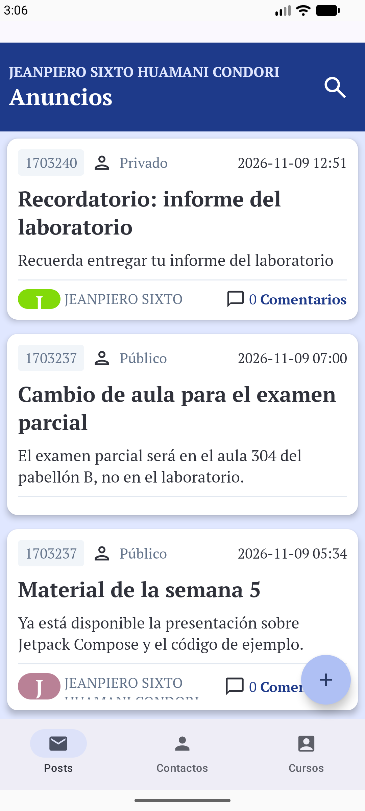 | 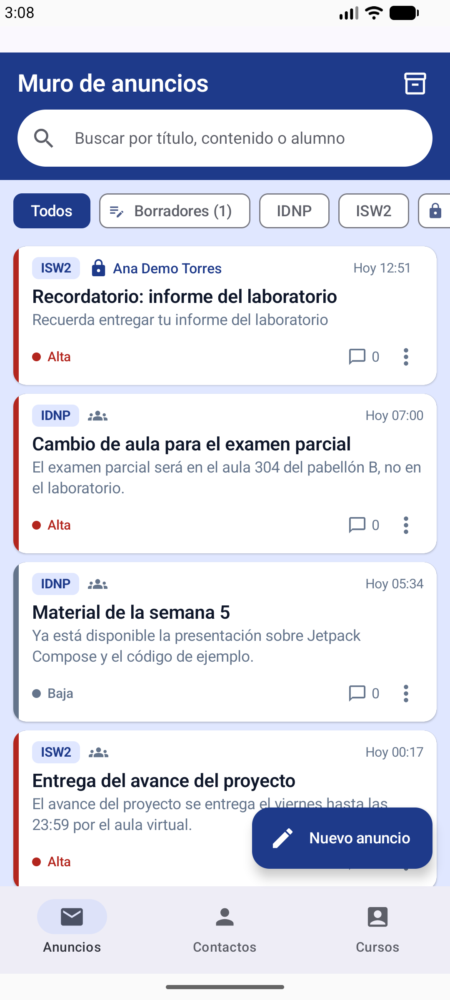 |
| Muestra el código del curso (`1703240`) en vez del nombre. Un anuncio privado no dice para quién es, no hay filtros ni prioridad y la fecha está en formato técnico. | Muestra la sigla del curso (ISW2, IDNP), y los privados llevan candado y el **nombre del alumno**. Hay buscador y filtros fijos (Todos, Borradores, cursos, Privados), la prioridad se marca con color y la fecha es relativa («Hoy 12:51»). |

### Búsqueda
| Antes | Después |
|---|---|
| 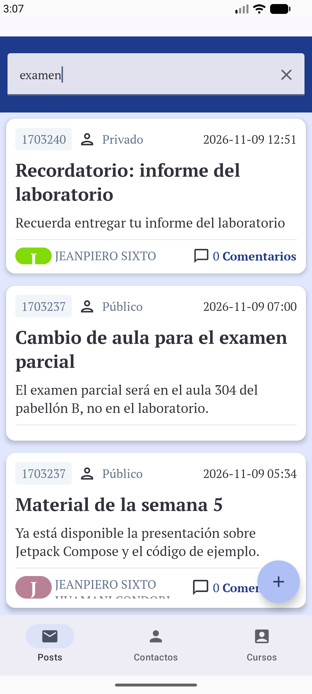 | 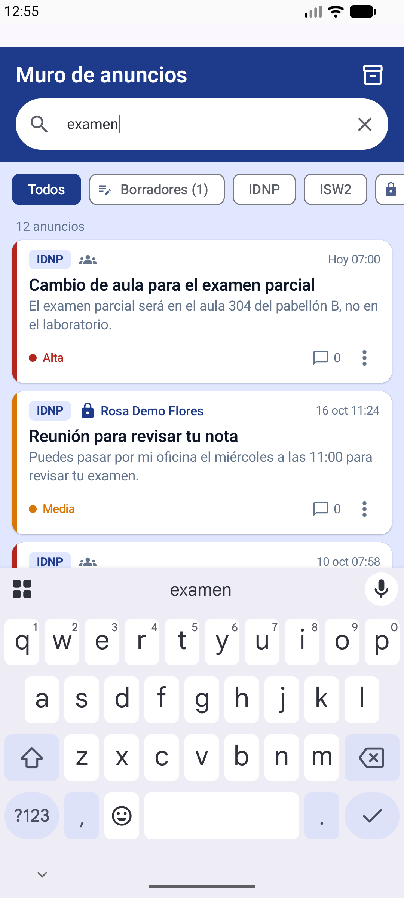 |
| El campo existía pero **no filtraba**: al buscar «examen» seguía apareciendo *Recordatorio: informe del laboratorio*. | Filtra por título o contenido mientras se escribe: 12 resultados para «examen». |
| | 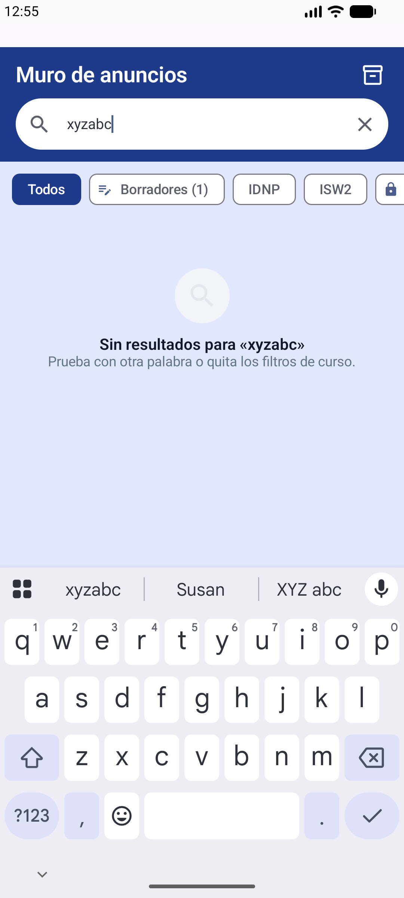 |
| | Cuando no encuentra nada lo dice y sugiere probar otra palabra. |

### Publicar un anuncio
| Antes | Después |
|---|---|
| 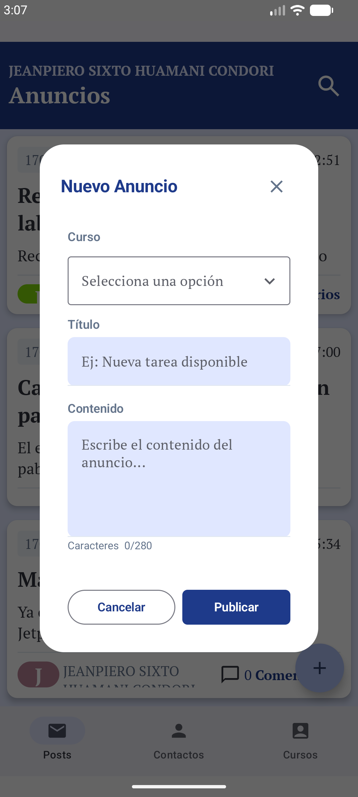 | 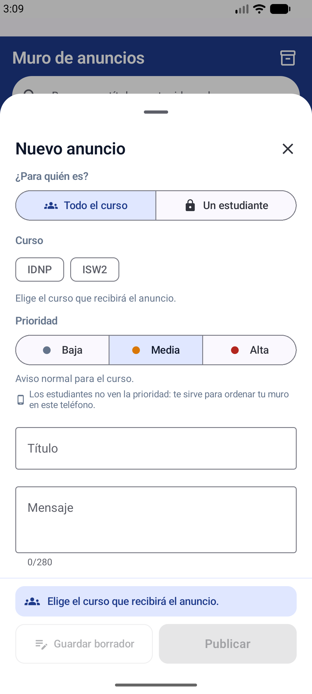 |
| Es un diálogo que solo permite elegir un curso, así que **no se pueden enviar anuncios privados**. Al cerrarlo se pierde lo escrito. | Es una hoja con **«¿Para quién es?»** (todo el curso o un estudiante) y prioridad con su explicación. Abajo hay una barra fija que resume quién lo recibirá y ofrece «Guardar borrador» o enviar. Al cerrarla con texto pregunta si se quiere guardar como borrador. |

### Anuncio privado (nuevo)
| Buscar al alumno | Formulario | Publicado en el muro |
|---|---|---|
| 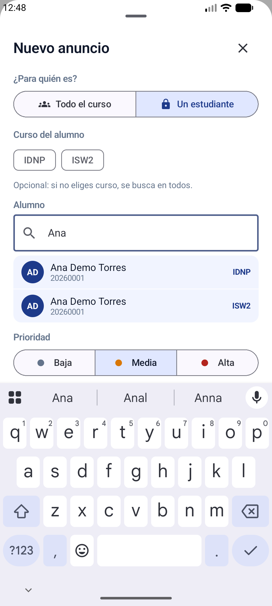 | 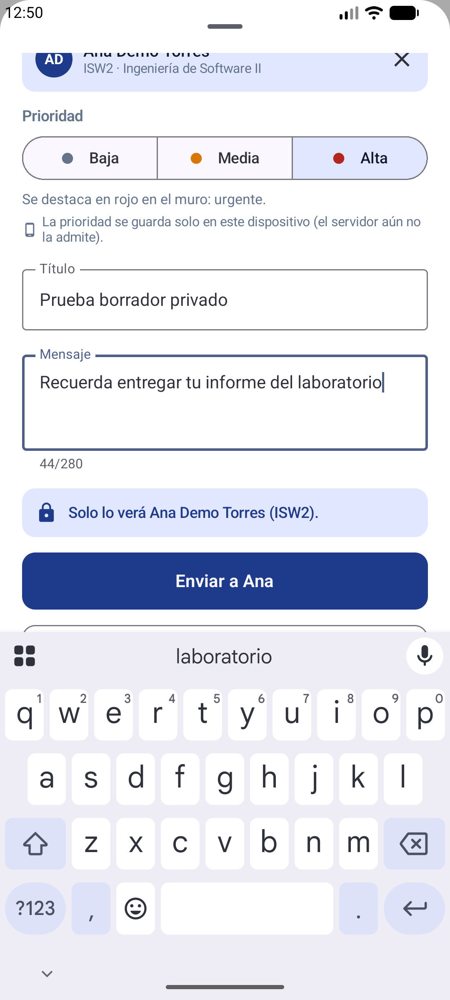 | 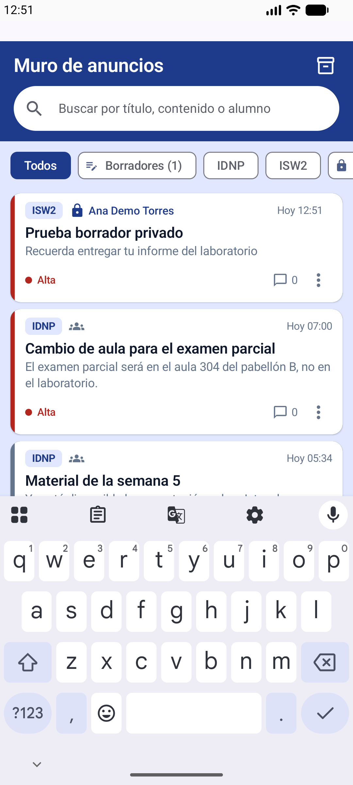 |

### Borradores (nuevo)
| Lista de borradores | Continuar editando | Otra cuenta no los ve |
|---|---|---|
| 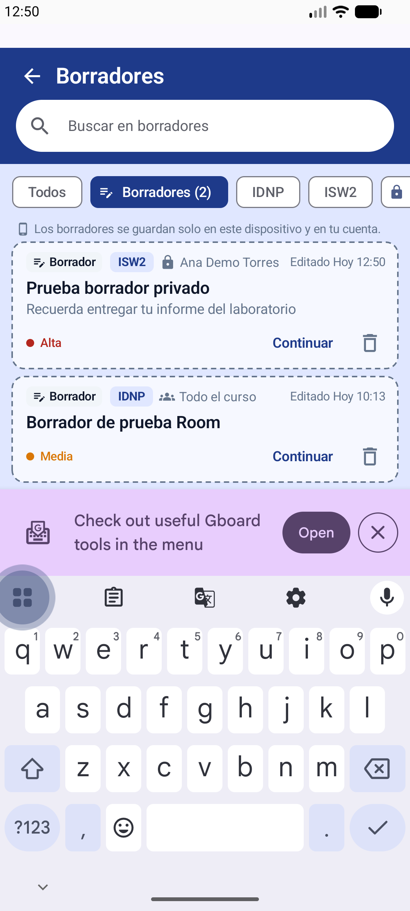 | 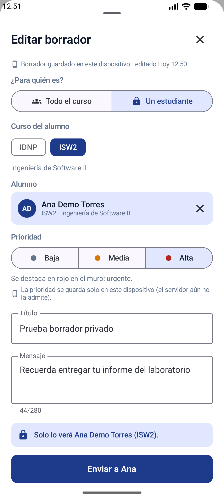 | 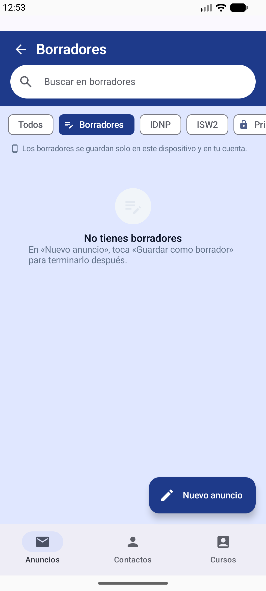 |

### Filtros y archivados (nuevo)
| Filtro por curso | Filtro de privados | Archivar con «Deshacer» |
|---|---|---|
| 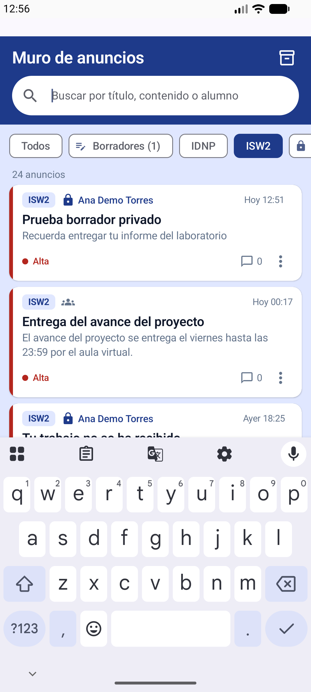 | 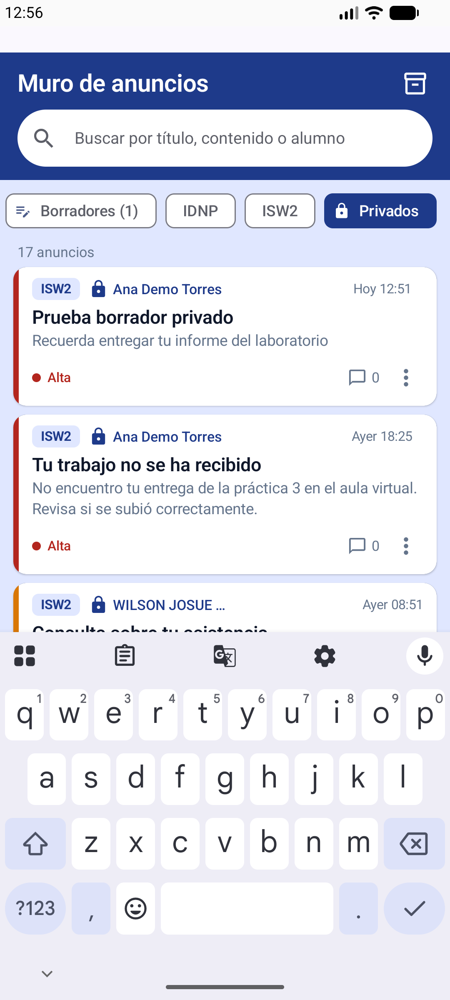 | 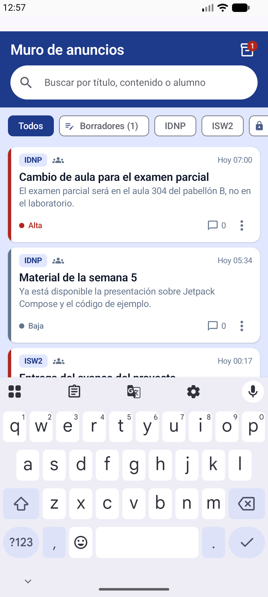 |

### Mejoras posteriores a la prueba de usabilidad
| Atrás pregunta antes de cerrar | Botones visibles con el teclado | Alumno una sola vez con sus cursos |
|---|---|---|
|  |  |  |

## Qué es simulado y qué usa el backend

| Función | Dónde se guarda | Cómo se ve en la app |
|---|---|---|
| Publicar anuncio de curso | **Backend** (`service-post-add`, corregida y desplegada: antes fallaba con *Internal Server Error*) | Normal |
| Publicar anuncio privado y su destinatario | **Backend** (`service-post-private-add`) | Normal |
| Prioridad | **Backend**: columna `post.priority` (migración en `Backend/supabase/migrations/`), se guarda al publicar con la función `set_post_priority` | Normal |
| Lista de anuncios, comentarios, cursos y alumnos | **Backend** | Normal |
| Búsqueda y filtros | En el teléfono, sobre los anuncios descargados del backend | Normal |
| Borradores | **Local**: Room, tabla `borradores`, separados por cuenta | Borde punteado, «Borrador» y el aviso *«Tus borradores se guardan en este teléfono…»* |
| Archivar o restaurar | **Local, simulada**: SharedPreferences por cuenta | 📱 y el texto *«Los anuncios archivados se guardan solo en este teléfono»* |
| Activar o desactivar comentarios | **Local, simulada** | 📱 y el texto *«Solo en este teléfono»* |

En otro teléfono, o después de reinstalar la app, lo simulado vuelve a su valor por defecto: nada archivado y comentarios activos.

## Archivos principales

```
AlertaUNI/app/src/main/java/com/erns/alertauni/
├── screen/post/
│   ├── PostScreen.kt            Muro, buscador, filtros, tarjetas, borradores, archivados
│   ├── NewAnnouncementSheet.kt  Hoja para publicar (curso o estudiante, prioridad, borrador)
│   ├── PostViewModel.kt         Estado del muro (StateFlow) y acciones
│   ├── AnnounceUi.kt            Modelos de interfaz y búsqueda
│   └── LocalOnlyNote.kt         Marca 📱 de lo que solo se guarda en el teléfono
├── data/model/DraftEntity.kt    Entidad Room de borradores
├── data/local/
│   ├── AppDatabase.kt           Base Room (versión 4, migración 2→4)
│   ├── DraftDao.kt              Consultas de borradores filtradas por ownerId
│   ├── SessionOwner.kt          Identifica la cuenta con sesión iniciada
│   └── AnnounceLocalStore.kt    Archivados y comentarios cerrados (local, por cuenta)
└── data/repository/DraftRepository*.kt

Backend/supabase/migrations/20261109000000_post_priority.sql   Columna post.priority y funciones
```

## Pruebas

- [**Funcionamiento**](Pruebas/Funcionamiento/README.md): 10 pruebas que pasaron, entre ellas borradores por cuenta, persistencia al cerrar la app, búsqueda, filtros y funciones existentes. Tienen 18 capturas.
- [**Usabilidad**](Pruebas/Usabilidad/): resultados de los testers con las tres tareas del enunciado.
- [**Evaluación y mejoras**](Pruebas/Evaluacion%20y%20mejoras/evaluacion_y_mejoras.md): problemas encontrados, correcciones y qué decisiones del diseño del examen se mantuvieron o se modificaron, con su justificación.

## Cómo ejecutar

1. Abrir `AlertaUNI/` en Android Studio con JDK 17.
2. Crear `local.properties` con la ruta del SDK.
3. Ejecutar en un dispositivo o emulador y entrar con una cuenta de Google de docente.
